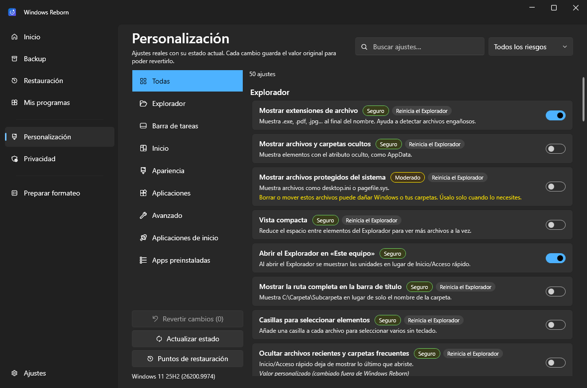
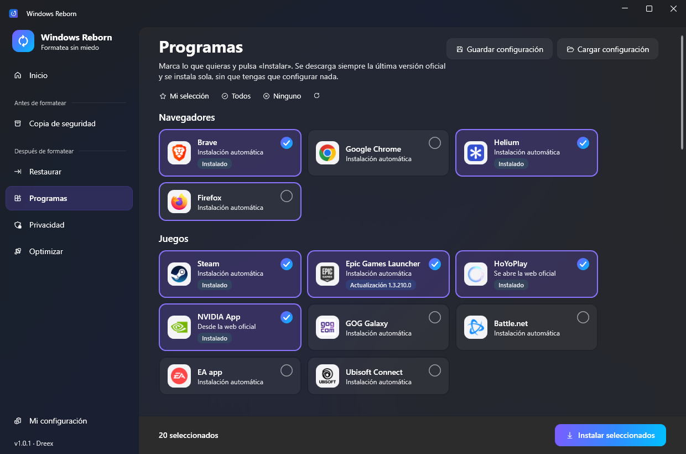
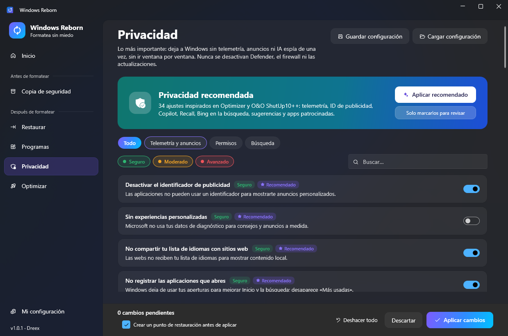

# Windows Reborn



**Windows Reborn** es una aplicación portátil para Windows 10 y 11 que hace todo lo
pesado de un formateo: **guarda tus cosas antes**, y **después** las devuelve a su sitio,
**instala tus programas** y **aplica tu privacidad y tus optimizaciones** con unos pocos clics.

> Funciona en local: sin telemetría, sin analítica, sin publicidad y sin cuentas. Solo se
> conecta a Internet para descargar programas o leer tus releases de GitHub.

## Qué hace

### Antes de formatear
- **Copia de seguridad por elementos**: marcas lo que quieres (Brave, .minecraft,
  Imágenes…) y se crea en el escritorio la carpeta *Copia Windows Reborn &lt;fecha&gt;* con:
  - `Configuración de apps.zip`: marcadores, ajustes y extensiones de **Brave, Chrome, Edge,
    Firefox, Opera, Opera GX, Vivaldi, Helium, Zen y LibreWolf (todos los perfiles)**, `.minecraft`, escenas de OBS, VS Code, Windows Terminal, Git.
    Nunca copia contraseñas, cookies ni sesiones.
  - `Archivos personales.zip`: Imágenes, Documentos, Descargas… o **cualquier carpeta** que añadas.
  - `Mi configuración.zip`: tus optimizaciones y programas elegidos.
- Cada zip se **verifica entero (SHA-256)** antes de darse por bueno.
- Enlaces directos a **Rufus** y a la **ISO oficial de Windows** para crear el USB.

### Después de formatear
- **Restaurar**: arrastra los zips (o la carpeta) y cada cosa vuelve a su **ruta original**,
  aunque tu usuario se llame distinto. Los perfiles del navegador vuelven a aparecer.
- **Programas**: casillas con lo habitual (Discord, NVIDIA App, Brave, Chrome, Helium, Epic
  Games, Steam, Spotify, OBS, Proton VPN, Cloudflare WARP, VS Code, Eclipse, VeraCrypt,
  EarTrumpet, HoYoPlay, Audacity, WinRAR, Git, Python, DaVinci Resolve, Malwarebytes, WhatsApp, Minecraft
  (Java, Windows heredado), Opera, Vivaldi, Zen, Mullvad Browser, Claude, ChatGPT y otras apps de IA, Windhawk,
  Android Studio, Visual Studio, Blender, GIMP, Signal, Rufus, LibreOffice y más),
  cada uno con
  su icono. Se instala
  siempre **la última versión oficial**, sin configurar nada. Detecta lo que ya tienes y
  ofrece actualizarlo.
- **Mis programas de GitHub**: lista los `.exe` que publicas en GitHub, descarga siempre la última
  versión, comprueba su SHA-256 y crea accesos directos.
  Con un token de solo lectura también aparecen tus **repos privados** (el token se guarda cifrado
  en el PC con DPAPI y solo va en «Mi configuración» si lo marcas, cifrado con una contraseña tuya
  mediante AES-256-GCM y PBKDF2).
- **Privacidad** (lo más importante): un botón aplica una configuración recomendada de
  ~35 ajustes (telemetría, ID de publicidad, Copilot, Recall, Bing en la búsqueda, apps
  patrocinadas, telemetría de Office/NVIDIA/Edge…).
- **Permisos**: cámara, micrófono, ubicación, contactos, calendario, documentos, imágenes… con tres
  estados que corresponden a los dos interruptores de Configuración (*Permitido*, *Bloqueado para las
  apps* y *Bloqueado en todo el equipo*). También se guardan los permisos de cada app.
- **Desinstalar programas**: quita de golpe la basura que trae Windows (Candy Crush y otras apps
  patrocinadas, Noticias, Teams personal, Copilot, Clipchamp, programas del fabricante…). Las
  recomendadas vienen marcadas y puede evitar que vuelvan a instalarse. Lista revisada con la de
  [Win11Debloat](https://github.com/Raphire/Win11Debloat); nunca toca la Store, WinGet ni los códecs.
- **Optimizar**: menú contextual clásico de Windows 10, ver extensiones, «Finalizar tarea»,
  modo de juego, rendimiento, apps de inicio y apps preinstaladas.
- Cada ajuste lleva **etiqueta de riesgo** (Seguro · Moderado · Avanzado), se guarda su valor
  original y **se puede deshacer**. Opcionalmente crea un punto de restauración.
  Nunca desactiva Defender, SmartScreen, UAC, Windows Update ni el firewall.

### Mi configuración
Exporta en un `.zip` todo lo que has elegido y, en cada formateo, impórtalo y pulsa
**Aplicar todo**: se aplican tus optimizaciones y se instalan tus programas.
Si tienes conectada tu cuenta de GitHub, puedes marcar *Incluir mi token de GitHub*: se guarda
cifrado con la contraseña que elijas y, al importarlo tras formatear, te la pide para volver a
conectar tus repos privados sin crear otro token.

También puedes guardar y cargar por separado la configuración de **Programas**,
**Privacidad** y **Optimizar** con los botones *Guardar configuración* y *Cargar configuración*
de cada sección. Al cargar, las opciones se marcan y no se aplica nada hasta que lo confirmes.





## Descarga y uso

1. Descarga `WindowsReborn.exe` de la [última versión publicada](https://github.com/Dreex14/WindowsReborn/releases/latest).
2. Ejecútalo: no necesita instalación ni .NET.
3. Modo portátil (datos junto al `.exe`): crea un archivo vacío `portable.flag` al lado.

Windows SmartScreen puede avisar porque el ejecutable no está firmado digitalmente.
Comprueba el SHA-256 publicado junto a la descarga.

Se muestra en español si la distribución del teclado es española y en inglés en otro caso
(se puede cambiar en *Mi configuración*).

## Compilar desde el código

Requisitos: [SDK de .NET 10](https://dotnet.microsoft.com/download).

```bash
dotnet test
dotnet publish src/WindowsReborn.App -c Release -o dist
```

Los textos se generan con `python tools/strings.py`.

| Proyecto | Responsabilidad |
|---|---|
| `WindowsReborn.Core` | Rutas, carpetas conocidas, ajustes, «Mi configuración», idiomas |
| `WindowsReborn.Storage` | Formato del zip, manifiesto, SHA-256, verificación |
| `WindowsReborn.Backup` | Elementos de copia (navegadores, Minecraft…), motor de copia |
| `WindowsReborn.Restore` | Restauración a la ruta original y conflictos |
| `WindowsReborn.Programs` | Catálogo de programas, instalador, apps de GitHub, descargas verificadas |
| `WindowsReborn.Tweaks` | Catálogo de ajustes (`catalog.json`), presets, diario de valores originales |
| `WindowsReborn.App` | Interfaz WPF (Fluent) |

## Qué hacen las herramientas externas y qué añade Windows Reborn

- **WinGet** (Microsoft) descarga e instala la mayoría de programas en segundo plano y
  verifica su hash. Windows Reborn elige el paquete, lo lanza y muestra el progreso.
- Para NVIDIA App y Eclipse se descarga el instalador de la **web oficial** y se comprueba
  su firma digital. HoYoPlay y DaVinci Resolve no permiten descarga automática: se abre su web.
- Las optimizaciones se inspiran en [Optimizer](https://github.com/hellzerg/optimizer)
  (GPL-3.0) y O&O ShutUp10++, y en la documentación de directivas de Microsoft. No se ha
  copiado código: son claves de registro documentadas, reescritas en `catalog.json`.

## Licencia

Código propio bajo licencia [MIT](LICENSE) — Copyright (c) 2026 Dreex.
Las dependencias tienen sus propias licencias: [THIRD-PARTY-NOTICES.md](THIRD-PARTY-NOTICES.md).

**Exención de responsabilidad:** el autor no se hace responsable del uso que se haga del
programa ni de los programas o contenidos de terceros que se descarguen o instalen con él.
Haz siempre más de una copia de tus datos importantes.

---

Hecho por **[Dreex](https://github.com/Dreex14)**.
